# Умный кредитный кабинет предпринимателя

> [!IMPORTANT]
> ## 🚀 Демо на VPS: [https://alfahack.dankosava.ru](https://alfahack.dankosava.ru)
>
> **Проверить все можно без локальной установки.** На VPS развернута полная система: тот же `compose.yaml`, шесть настоящих Java-сервисов, PostgreSQL, без моков на frontend. Можно пройти весь путь клиента от заявки до выдачи кредита, поработать за сотрудника банка и администратора продуктов.
>
> Вход: [alfahack.dankosava.ru/demo-access](https://alfahack.dankosava.ru/demo-access) — выберите роль и введите демотокен:
>
> | Роль | Демотокен |
> | --- | --- |
> | Предприниматель | `demo-customer-only` |
> | Сотрудник банка | `demo-staff-only` |
> | Администратор продуктов | `demo-product-admin-only` |
>
> Для основного сценария выберите компанию **ООО «Демо Мастерская»**. Остальные демо-компании показывают отказ, дозапрос и ручное рассмотрение — см. [Демо-компании](#демо-компании).

Веб-прототип цифрового кредитного конвейера для малого и микробизнеса. Предприниматель выбирает продукт, заполняет заявку и проходит весь путь до моделируемой выдачи денег. Банк проверяет данные через моки внешних источников, считает скоринг, принимает решение автоматически или руками сотрудника, готовит договор и проводит выдачу.

**Требования:** [REQUIREMENTS.md](REQUIREMENTS.md) · **Баг-репорт:** [Google Docs](https://docs.google.com/document/d/13Tuv6Pb-u68MinwhydwnUdNZF7DAJqo9a1JtFtn9CsI/edit)

## Содержание

- [Ключевые возможности](#ключевые-возможности)
- [Быстрый старт](#быстрый-старт)
- [Архитектура](#архитектура)
- [Жизненный цикл заявки](#жизненный-цикл-заявки)
- [Флоу запросов](#флоу-запросов)
- [Кредитная логика](#кредитная-логика)
- [Модель данных](#модель-данных)
- [Надежность и согласованность](#надежность-и-согласованность)
- [Доступ и безопасность](#доступ-и-безопасность)
- [API](#api)
- [Технологии](#технологии)
- [Тестирование](#тестирование)
- [Разработка](#разработка)
- [Документация](#документация)

## Ключевые возможности

- **Сквозной процесс** от выбора продукта до подтвержденного зачисления: 15 статусов заявки, история каждого перехода, неизменяемые версии данных.
- **Прозрачный скоринг**: балльная модель из четырех факторов и отдельные стоп-правила. Клиент видит, что повлияло на решение.
- **Нестандартные ветки**: дозапрос сведений, ручное рассмотрение, встречное предложение, смена условий, отказ, отмена, истечение сроков.
- **Банковская сторона**: очередь ручного рассмотрения для сотрудника, админ-панель публикации версий продуктов.
- **Надежность**: идемпотентные команды, долговечные задания с lease, повторы с backoff, защита от двойной выдачи. Технический сбой не превращается в кредитный отказ.
- **Автономность**: все внешние системы (ЕГРЮЛ, БКИ, ФНС, подпись, платежи) заменены синтетическими моками. Стек поднимается одной командой Docker Compose.

## Быстрый старт

Нужен только Docker (Docker Desktop на macOS/Windows). Java, Node.js и PostgreSQL на хосте не требуются. Java-образы собираются только с локальным дистрибутивом Gradle из `gradle-dist/` ([подробнее](gradle-dist/README.md)):

```bash
curl -fL -o gradle-dist/gradle-8.14.3-bin.zip https://services.gradle.org/distributions/gradle-8.14.3-bin.zip
docker compose -p alfa-local up --build -d --wait --wait-timeout 300
docker compose -p alfa-local ps     # migrate в статусе Exited (0) — это нормально
```

Открыть **http://localhost:8080/demo-access** и войти по демотокену:

| Роль | Токен | Что доступно |
| --- | --- | --- |
| Предприниматель | `demo-customer-only` | Каталог, заявки, договор, подпись |
| Сотрудник банка | `demo-staff-only` | Очередь ручного рассмотрения `/staff/manual-reviews` |
| Администратор продуктов | `demo-product-admin-only` | Публикация версий продуктов `/admin/products` |

Для параллельной работы двух ролей используйте разные профили браузера или обычное и приватное окна.

> Сборка шести Java-сервисов требует памяти. Выделите Docker не меньше 6 ГБ (Docker Desktop → Settings → Resources). При медленной сети собирайте образы по одному: `docker compose -p alfa-local build <service>`.

### Демо-компании

У демо-клиента пять синтетических компаний. Каждая ведет заявку по своей ветке процесса:

| Компания | Сценарий |
| --- | --- |
| ООО «Демо Мастерская» | Основной путь: предложение → договор → подпись → выдача |
| ООО «Демо Просрочка» | Автоматический отказ: текущая просрочка в БКИ |
| ООО «Демо Нужны сведения» | Дозапрос сведений от клиента (`NEEDS_INFO`) |
| ООО «Демо Спорные данные» | Спорные факты источников → ручное рассмотрение |
| ООО «Демо Ручной анализ» | Пограничный балл риска → решение сотрудника |

Пошаговый сценарий основного пути и остальных веток: [docs/local-docker.md](docs/local-docker.md).

```bash
docker compose -p alfa-local logs -f applications worker   # логи
docker compose -p alfa-local down                           # остановить, данные сохранятся
docker compose -p alfa-local down -v                        # остановить и сбросить БД к seed
```

## Архитектура

Система состоит из шести backend-сервисов на Java 21, SPA на React и gateway на nginx. Каждый сервис владеет своей базой данных и общается с соседями только по HTTP. Брокера сообщений нет: процессом управляет `applications` через долговечные задания в своей БД.

### Контекст

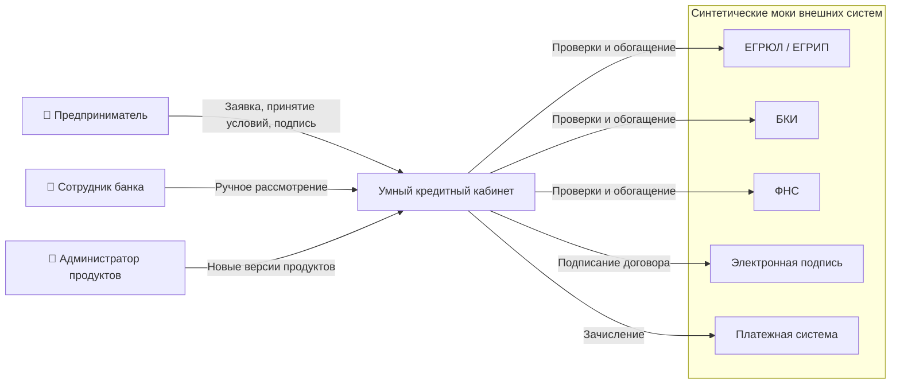

Моки встроены в сервисы-владельцы: источники проверки — в `verification`, подпись — в `agreements`, счета и зачисление — в `disbursement`. Каждый мок хранит синтетические фикстуры в БД своего сервиса и сохраняет смысл исходной интеграции.

### Компоненты

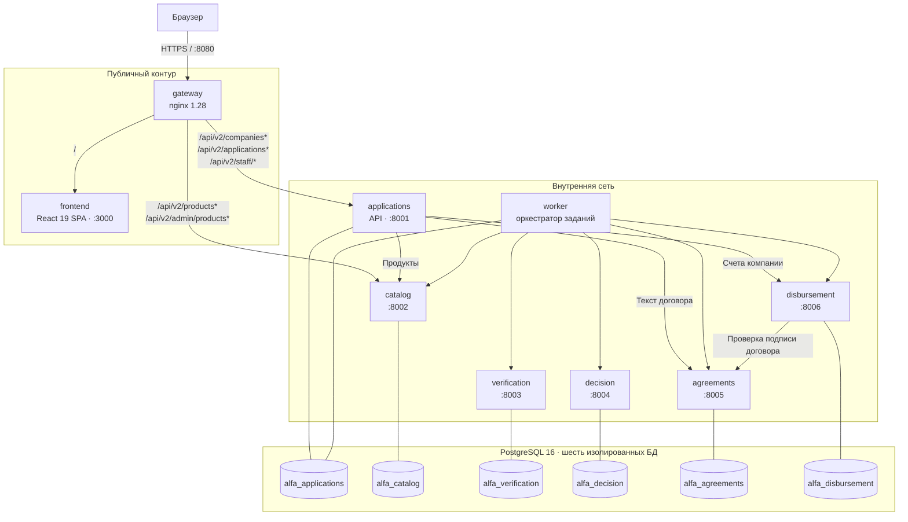

Наружу открыт только порт gateway `8080`. Gateway срезает префикс `/api` и не пропускает внутренние маршруты: любой другой `/api/*` получает `404`. `applications` и `worker` — один образ в двух режимах: HTTP API и фоновый обработчик заданий.

### Сервисы

| Сервис | Ответственность | Собственные данные |
| --- | --- | --- |
| [applications](services/applications/README.md) | Доступ и роли, черновики и версии данных, глобальный статус, дозапросы и сроки, команды клиента и сотрудника, оркестрация процесса | Компании, заявки, снимки данных, история, задания, дозапросы, принятые предложения, поручения на выдачу |
| [catalog](services/catalog/README.md) | Кредитные продукты, ограничения и ставки, публикация новых версий администратором | Неизменяемые версии продуктов, указатели текущих версий, аудит публикаций |
| [verification](services/verification/README.md) | Моки ЕГРЮЛ, БКИ и ФНС; полнота и согласованность фактов; уточнения сотрудника | Фикстуры источников, исходные и подтвержденные факты |
| [decision](services/decision/README.md) | Скоринг, кредитное решение, альтернативные условия, дела ручного рассмотрения | Оценки, решения, предложения, дела и действия сотрудников |
| [agreements](services/agreements/README.md) | Договор по принятому предложению, срок подписания, подпись, закрытие | Неизменяемые документы с SHA-256, подписи |
| [disbursement](services/disbursement/README.md) | Проверка реквизитов, однократное моделируемое зачисление, поиск операции | Фикстуры счетов, проверки реквизитов, операции, записи зачисления |
| [frontend](frontend/README.md) | Кабинеты клиента, сотрудника и администратора | Нет: только публичные API `applications` и `catalog` |

### Развертывание

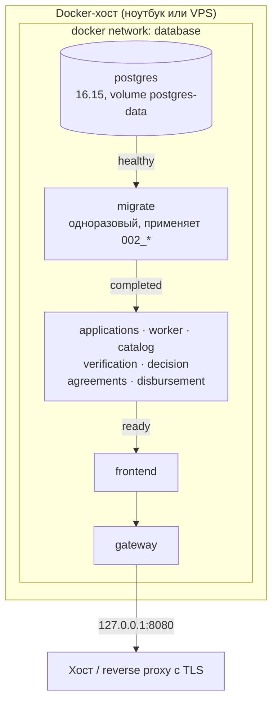

Порядок старта задан через `depends_on` и healthcheck. PostgreSQL при первом запуске создает шесть БД, ролей и применяет `001_initial.sql` с seed. Контейнер `migrate` применяет следующие миграции от имени владельцев схем. Сервисы подключаются ролями `*_app` только с DML-правами. Каждый сервис отдает `/health/live` и `/health/ready`; readiness проверяет свою БД и наличие seed.

## Жизненный цикл заявки

Глобальным статусом владеет только `applications`. `IN_REVIEW` — составной статус с вложенным `reviewStage`: сначала `ENRICHMENT`, затем `SCORING`.

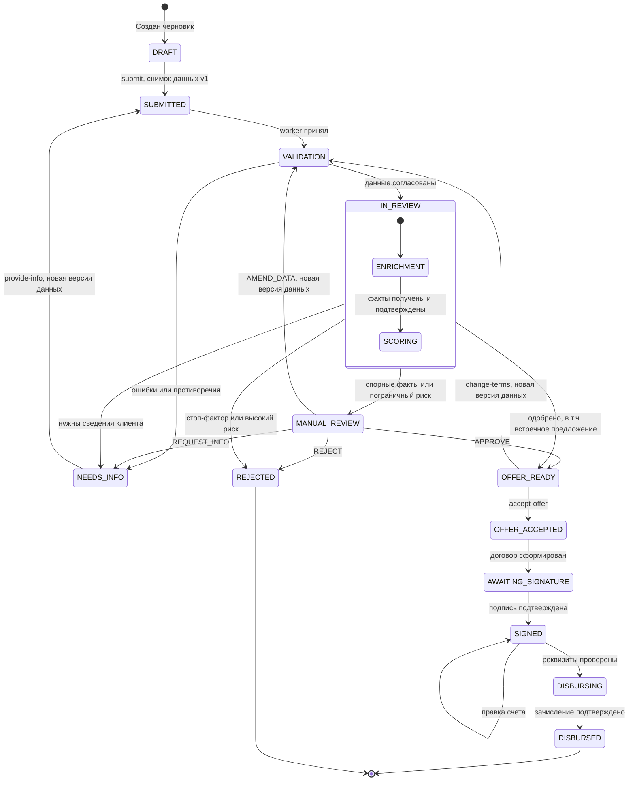

Переходы в отмену и истечение срока не показаны выше, чтобы не перегружать схему:

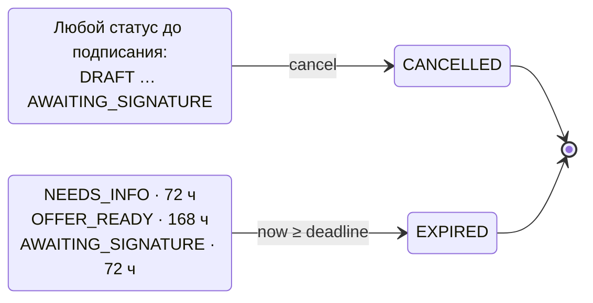

| Группа | Статусы |
| --- | --- |
| Подача | `DRAFT`, `SUBMITTED`, `VALIDATION` |
| Рассмотрение банком | `IN_REVIEW` (`ENRICHMENT` → `SCORING`), `MANUAL_REVIEW` |
| Ожидание клиента | `NEEDS_INFO`, `OFFER_READY`, `AWAITING_SIGNATURE` |
| Оформление и выдача | `OFFER_ACCEPTED`, `SIGNED`, `DISBURSING` |
| Конечные | `DISBURSED`, `REJECTED`, `CANCELLED`, `EXPIRED` |

Правила, общие для всех переходов:

- **Версии данных.** Отправка создает неизменяемый снимок `dataVersion=1`. Дозапрос, правка сотрудника и смена условий создают снимок `dataVersion+1` и заново проходят проверки и скоринг. Результаты старой версии не применяются к новой.
- **История.** Каждый переход, включая `ENRICHMENT → SCORING`, атомарно пишет запись в timeline: время, инициатор (клиент, сотрудник, система), причина, версия данных.
- **Сроки.** На границе `now = deadline` действие уже недоступно, даже если таймер еще не записал `EXPIRED`.
- **Технические ошибки.** Сбой не меняет `status` и `reviewStage`. Ошибка, попытки и возможность повтора хранятся в отдельном поле `technicalError`; клиент видит действие `RETRY_PROCESSING`.
- **Следующее действие.** Сервер вычисляет `availableActions` для клиента по статусу и текущему времени: `EDIT`, `SUBMIT`, `PROVIDE_INFO`, `CHANGE_TERMS`, `ACCEPT_OFFER`, `SIGN`, `CANCEL`, `UPDATE_PAYOUT_ACCOUNT`, `RETRY_PROCESSING`.

Точные guards каждого перехода: [docs/workflow.md](docs/workflow.md). Бизнес-обоснование модели: [docs/application-state-model.md](docs/application-state-model.md).

### Состояния вспомогательных сущностей

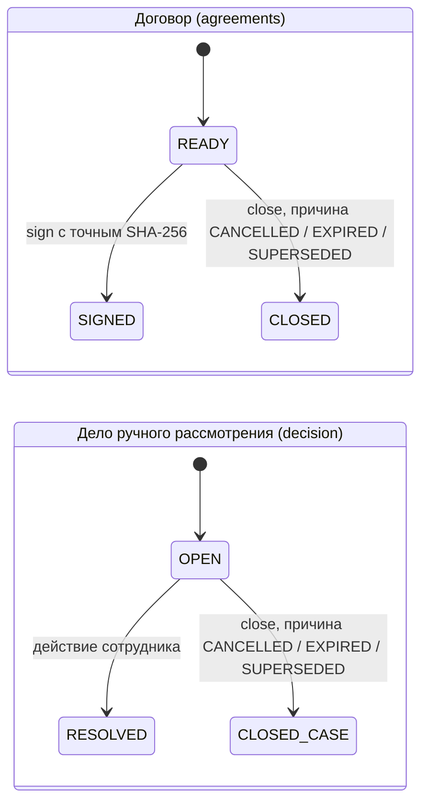

Из `READY` побеждает ровно один переход: `sign` и `close` конкурируют в одной транзакционной блокировке договора.

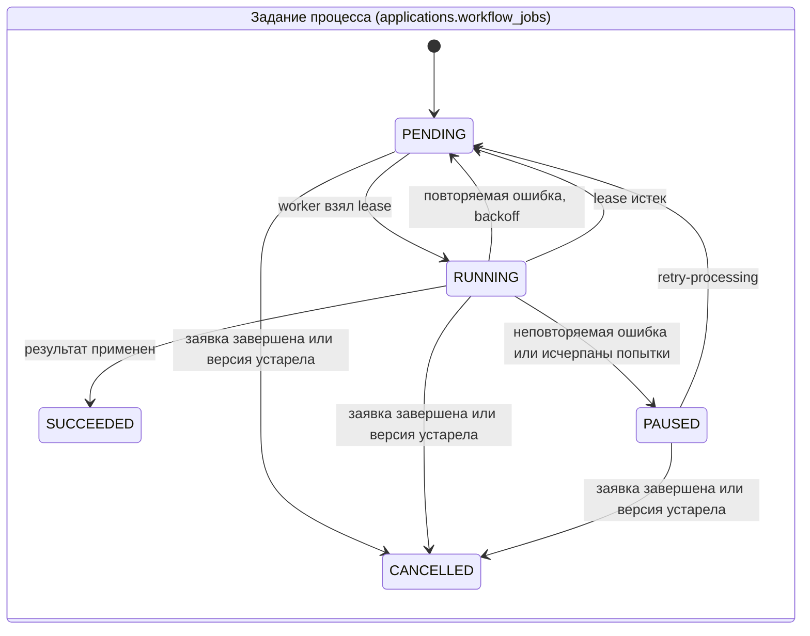

Шаги заданий: `VALIDATION`, `ENRICHMENT`, `SCORING`, `MANUAL_CASE`, `MANUAL_ACTION`, `AGREEMENT`, `SIGNATURE`, `PAYOUT_VALIDATION`, `DISBURSEMENT`, `CLOSURE`. На заявку допускается одно активное задание процесса.

## Флоу запросов

Команды процесса (`submit`, `accept-offer`, `sign` и др.) отвечают `202 Accepted` сразу после атомарного сохранения намерения, задания и истории. Фактический результат клиент читает в заявке: frontend опрашивает `GET /v2/applications/{id}`.

### Создание и отправка заявки

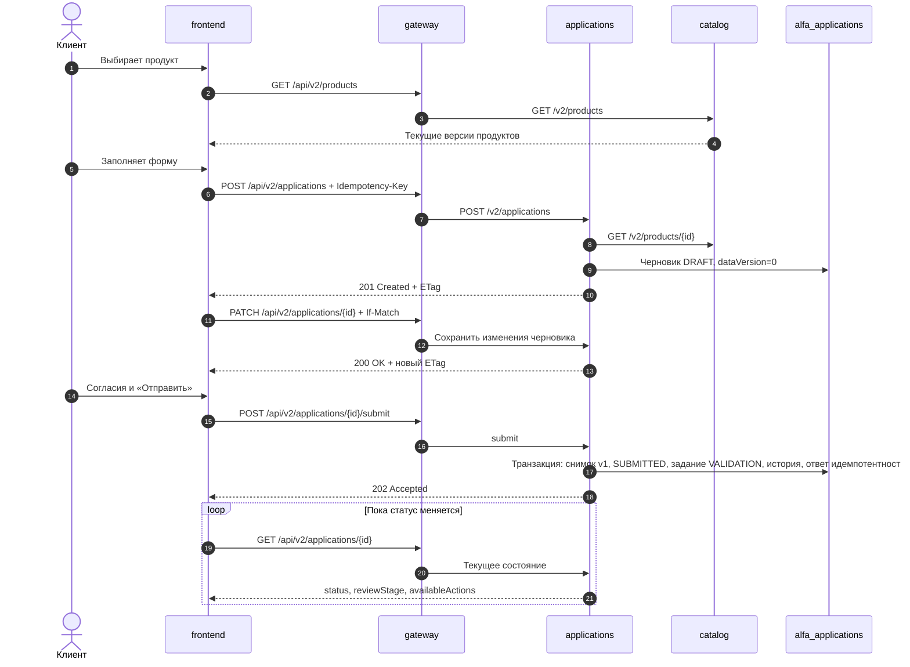

### Рассмотрение: проверки и скоринг

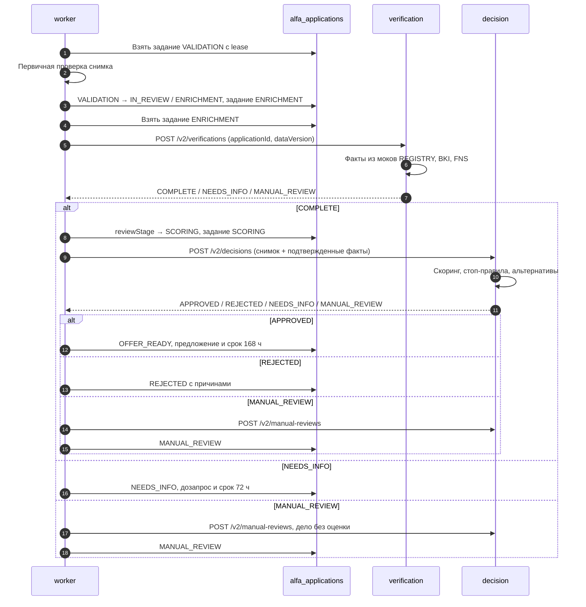

Перед каждым внешним вызовом worker сохраняет точный запрос и ключ идемпотентности. Результат применяется только если заявка все еще в ожидаемых `status`, `reviewStage` и `dataVersion`. Поздний ответ по устаревшей версии или отмененной заявке сохраняется у исполнителя, но не двигает процесс.

### Ручное рассмотрение

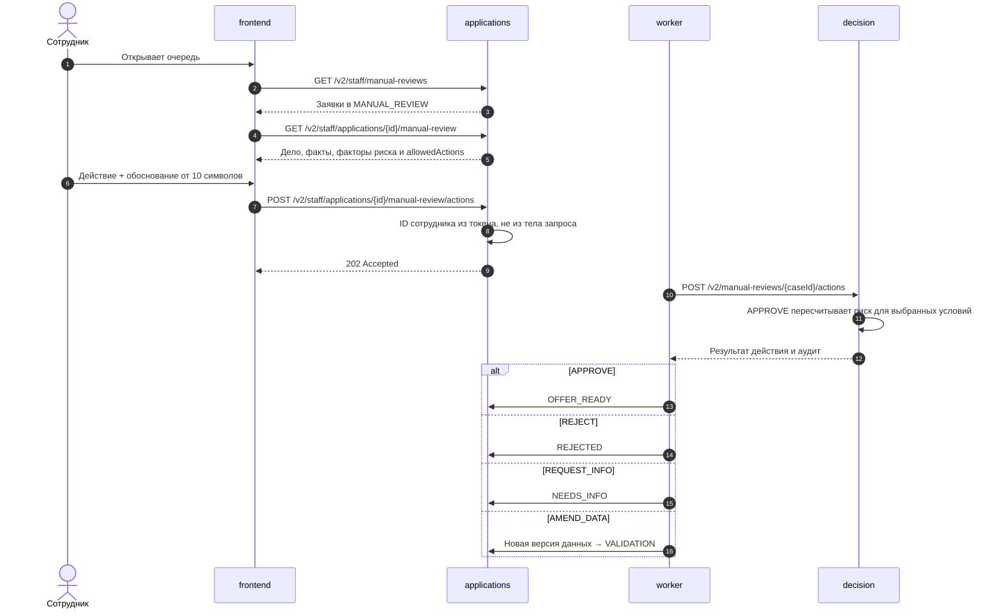

`APPROVE` невозможен без завершенного скоринга текущей версии и не обходит стоп-правила. Сотрудник не может принять предложение или подписать договор за клиента.

### Принятие предложения, договор, подпись и выдача

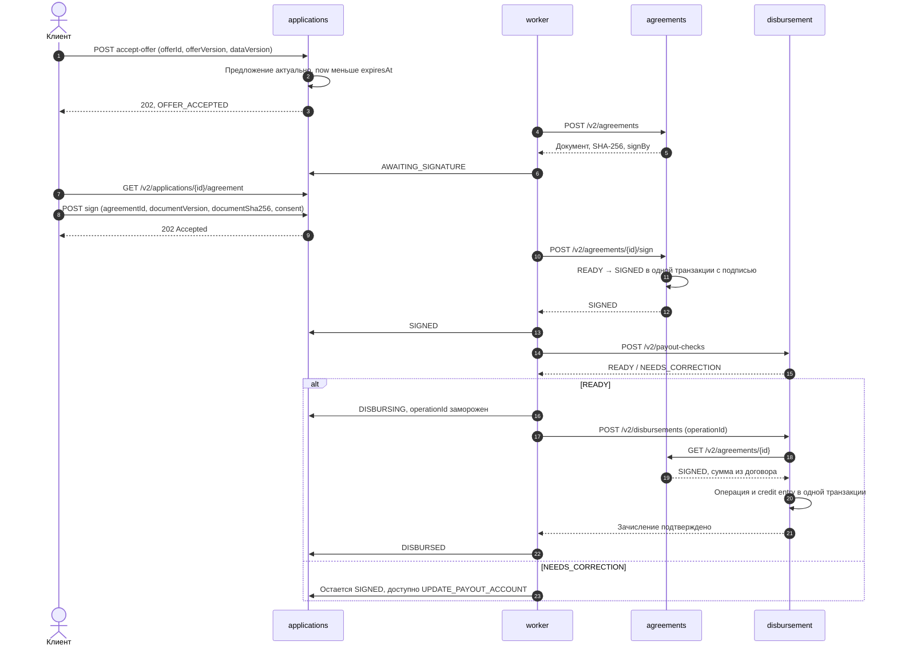

### Восстановление после потерянного ответа выдачи

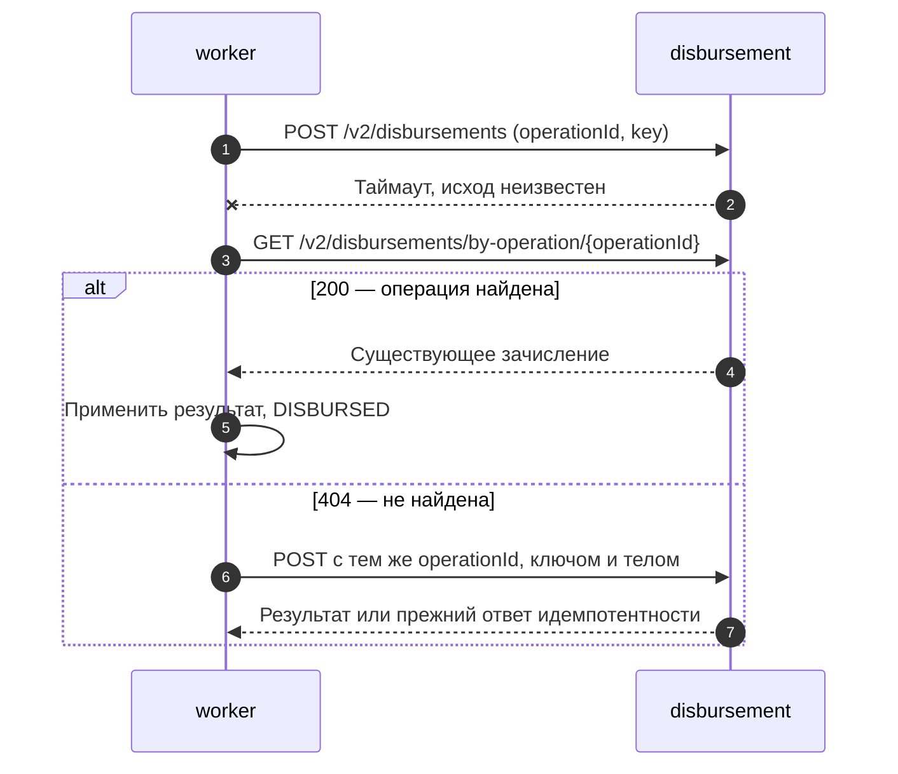

Повтор не создает второе зачисление: уникальны `applicationId`, `agreementId` и `operationId`, а credit entry пишется одна на выдачу.

### Отмена во время подписания

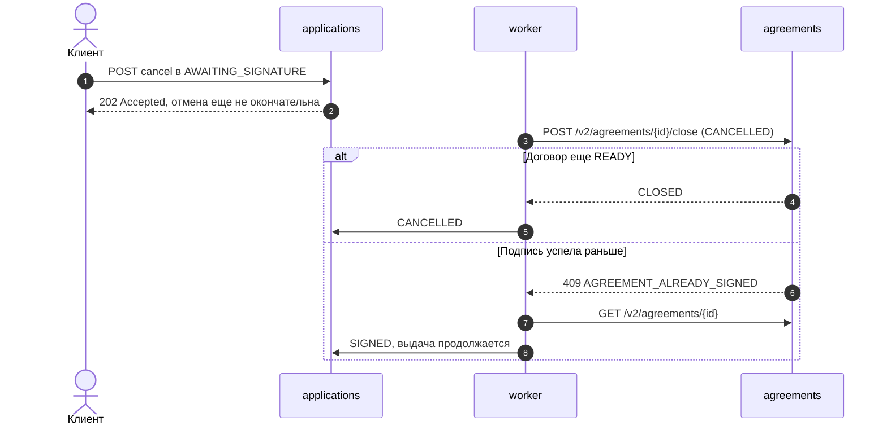

Так же разрешается гонка истечения срока с подписью. Пока исход не определен, выдача не запускается.

## Кредитная логика

`demo-policy-v2` — синтетические детерминированные правила, а не реальная политика банка. Логика разделена на два шага:

- **Скоринг** оценивает риск заемщика и дает балл от 300 до 900.
- **Кредитное решение** учитывает балл, стоп-факторы, ограничения продукта и параметры кредита. Результат — одобрение, встречное предложение, ручное рассмотрение, дозапрос или отказ.

Расчет выполняет сервис `decision`: [Policy.java](services/decision/src/main/java/ru/alfa/decision/Policy.java). Одинаковые входные данные всегда дают одинаковый результат.

### Входные данные

| Данные | Источник | Используются для |
| --- | --- | --- |
| Сумма, срок, цель, продукт | Заявка клиента | Платеж, лимиты продукта |
| Месячная выручка, расходы, текущие платежи по кредитам | Заявка клиента | Свободный поток и долговая нагрузка |
| Кредитный балл БКИ (0–1000), текущая просрочка | Мок БКИ | Фактор «Кредитная история», стоп-фактор |
| Статус компании, дата регистрации | Мок ЕГРЮЛ / ЕГРИП | Стоп-фактор, возраст бизнеса |
| Налоговый долг | Мок ФНС | Стоп-фактор |
| Ставка, лимиты суммы и срока, цели, мин. возраст, макс. нагрузка | Версия продукта из catalog | Платеж, стоп-факторы |

Скоринг работает только с подтвержденными фактами текущей версии данных. Если источник вернул спорные факты, заявка сначала уходит сотруднику, и балл не считается.

### Шаг 1. Платеж, свободный поток и нагрузка

```text
r                = annualRateBps / 10000 / 12                       — месячная ставка
Платеж           = ⌈ Сумма × r / (1 − (1 + r)^(−Срок)) ⌉                — аннуитет, округление вверх до рубля
                   ⌈ Сумма / Срок ⌉ при нулевой ставке
Свободный поток  = Выручка − Расходы
Нагрузка, б.п.   = ⌈ (Текущие платежи + Платеж) / Свободный поток × 10000 ⌉
                   не считается, если Свободный поток ≤ 0
```

Деньги — целые рубли, ставки и доли — базисные пункты (100 б.п. = 1%). Промежуточные значения считаются точно через `BigDecimal`, округляется только итоговый платеж.

### Шаг 2. Балл риска

| Фактор | Условие → баллы | Почему этот фактор |
| --- | --- | --- |
| База | всегда 300 | Стартовая оценка |
| Кредитная история (БКИ) | ≥ 750 → **250** · 600–749 → **150** · < 600 → **0** | Как заемщик платил раньше |
| Возраст бизнеса | ≥ 24 мес. → **150** · 12–23 мес. → **75** · < 12 мес. → **0** | Молодой бизнес чаще закрывается |
| Долговая нагрузка | ≤ 30% → **200** · 30–50% → **100** · > 50% или не считается → **0** | Хватит ли денег на новый платеж |

Сумма баллов — от 300 до 900. Класс риска: `LOW` от 800, `MEDIUM` 600–799, `HIGH` ниже 600. Балл — относительная оценка риска, а не вероятность одобрения.

### Шаг 3. Стоп-факторы

Стоп-фактор запрещает одобрение при любом балле, в том числе при 900.

| Код | Условие |
| --- | --- |
| `REGISTRY_INACTIVE` | Компания неактивна в реестре |
| `CURRENT_OVERDUE` | Есть текущая просрочка в БКИ |
| `TAX_DEBT_LIMIT` | Налоговый долг больше 100 000 ₽ |
| `BUSINESS_TOO_YOUNG` | Возраст бизнеса меньше минимума продукта |
| `NON_POSITIVE_CASH_FLOW` | Свободный поток ≤ 0 |
| `DEBT_BURDEN_LIMIT` | Нагрузка выше максимума продукта |
| `PRODUCT_LIMITS` | Сумма, срок или цель вне ограничений продукта |

### Шаг 4. Решение

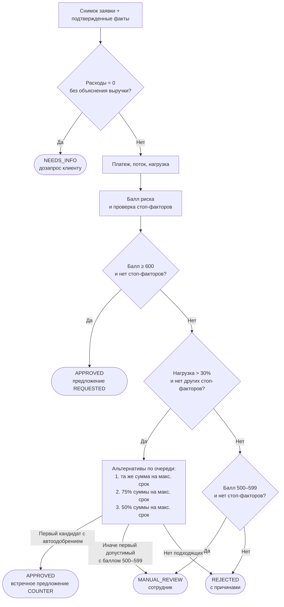

Для каждой альтернативы платеж, нагрузка, балл и все ограничения считаются заново. Суммы альтернатив — целые рубли, не ниже минимума продукта, дубликаты исключаются. В ответе сохраняются все оцененные варианты (`evaluatedTerms`) и выбранный (`selectedTermsId`). Другой продукт клиент выбирает сам через «Изменить условия».

### Примеры расчета

Продукт «На развитие бизнеса» (24% годовых). Компании и факты — из демо-данных.

| Сценарий | Входные данные | Расчет | Итог |
| --- | --- | --- | --- |
| **Одобрение** · «Демо Мастерская» | 1 000 000 ₽ на 12 мес.; выручка 1 000 000, расходы 500 000, платежи 20 000; БКИ 800, возраст 81 мес. | Платеж 94 560 ₽, нагрузка 22,9% → 300 + 250 + 150 + 200 = **900** | `APPROVED`, исходные условия |
| **Встречное предложение** · «Демо Мастерская» | 3 000 000 ₽ на 12 мес., остальное как выше | Платеж 283 679 ₽, нагрузка 60,7% выше лимита 50% → `DEBT_BURDEN_LIMIT`. Альтернатива 3 000 000 ₽ на 36 мес.: платеж 117 699 ₽, нагрузка 27,5% → **900** | `APPROVED`, `COUNTER`: та же сумма на 36 мес. |
| **Ручное рассмотрение** · «Демо Ручной анализ» | 1 000 000 ₽ на 36 мес.; выручка 1 000 000, расходы 500 000, платежи 160 000; БКИ 620, возраст 9 мес. | Платеж 39 233 ₽, нагрузка 39,9% → 300 + 150 + 0 + 100 = **550**. Альтернативы 750 000 и 500 000 ₽ тоже дают 550 | `MANUAL_REVIEW` |
| **Отказ** · «Демо Просрочка» | Любые корректные условия; БКИ 800, но есть текущая просрочка | Балл может быть 900 | `REJECTED`: `CURRENT_OVERDUE` |

### Кто решает: система или сотрудник

| Ситуация | Решает | Почему |
| --- | --- | --- |
| Балл ≥ 600, нет стоп-факторов | Система | Риск низкий или средний, правила однозначны |
| Есть стоп-фактор | Система | Жесткое ограничение банка, обсуждать нечего |
| Нагрузка высокая, но есть подходящий вариант | Система | Встречное предложение считается по тем же правилам |
| Балл 500–599 | Сотрудник | Пограничный риск: нужен взгляд человека на бизнес |
| Источники противоречат заявке | Сотрудник | Автомат не может понять, чему верить |

Сотрудник может одобрить, отказать, запросить сведения у клиента или уточнить данные. Ограничения ручного решения:

- **одобрение** возможно только после завершенного скоринга текущей версии данных и только без стоп-факторов. Риск для выбранных условий пересчитывается заново;
- **отказ** допускается и без скоринга, например при спорных данных;
- **уточнение данных** создает новую версию заявки, и она заново проходит проверки и скоринг;
- любое действие требует обоснования от 10 символов. В аудит сохраняются ID сотрудника, время и причина.

### Что видит клиент

Карточка заявки показывает итоговый балл и класс риска, учтенные факторы, причины решения простым языком (например, «Есть текущая просрочка»), а при одобрении — условия предложения в сравнении с запрошенными. API решения дополнительно возвращает баллы каждого фактора, свободный поток, нагрузку и все оцененные варианты условий (`evaluatedTerms`).

### Продукты в seed

| Продукт | Сумма, ₽ | Срок, мес. | Ставка | Мин. возраст бизнеса | Макс. нагрузка |
| --- | --- | --- | --- | --- | --- |
| На развитие бизнеса (`working-capital`) | 100 000 – 5 000 000 | 6–36 | 24% | 6 мес. | 50% |
| На оборудование (`equipment-finance`) | 100 000 – 10 000 000 | 12–60 | 22% | 12 мес. | 50% |

Администратор публикует новую неизменяемую версию продукта. Уже созданные заявки, предложения и договоры сохраняют свою версию.

## Модель данных

Каждый сервис владеет своей БД. Связи между сервисами — только UUID без межбазовых внешних ключей и JOIN.

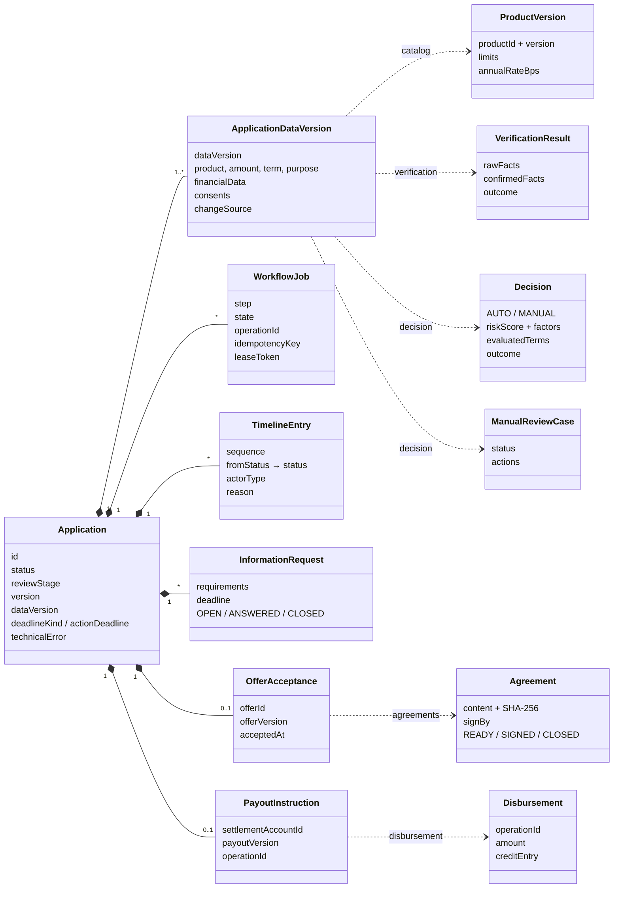

Сплошные связи — данные внутри `alfa_applications`, пунктир — ссылки по UUID на ресурсы других сервисов. Результаты проверок, решения и договоры привязаны к паре `(applicationId, dataVersion)`.

Физические SQL-схемы и ER-диаграммы всех шести БД: [database/README.md](database/README.md) · [общая схема SVG](database/diagrams/overview.svg). Предметные сущности и инварианты: [docs/data-model.md](docs/data-model.md).

## Надежность и согласованность

| Механизм | Как работает |
| --- | --- |
| Идемпотентность | Все `POST` и `PATCH` требуют `Idempotency-Key`. Ответ сохраняется в той же транзакции, что и изменение. Повтор возвращает прежний ответ, тот же ключ с другим телом — `409 IDEMPOTENCY_CONFLICT` |
| Оптимистичная блокировка | Команды над заявкой требуют `If-Match` с ETag. Устаревший ETag — `412`, отсутствие — `428` |
| Долговечные задания | Каждый шаг процесса — запись `workflow_jobs` в БД. Worker берет задание с lease и токеном владения. После падения worker задание возвращается в очередь |
| Повторы | Сетевые сбои, `408`, `429`, `5xx` — до пяти попыток с задержками 1/2/4/8 с, jitter и `Retry-After`. Затем задание ставится на паузу, клиент может нажать «Повторить» |
| Таймауты | Подключение 2 с, ответ 10 с |
| Защита от поздних ответов | Результат применяется только при совпадении ожидаемых `status`, `reviewStage`, `dataVersion` и ID задания |
| Однократная выдача | Постоянный `operationId`, поиск операции перед повтором, уникальные ключи и одна credit entry |
| Неизменяемость | Снимки данных, версии продуктов, решения, предложения и договоры не изменяются. Новые данные — новая версия |

Подробнее: [docs/architecture.md](docs/architecture.md#технические-ошибки-и-однократное-выполнение).

## Доступ и безопасность

| Токен | Кто | Куда пускает |
| --- | --- | --- |
| `CustomerBearer` | Предприниматель | Свои компании и заявки; чужие ресурсы — `404` |
| `StaffBearer` | Сотрудник | Очередь и дела ручного рассмотрения; клиентские действия — `403` |
| `AdminBearer` | Администратор продуктов | Только `/v2/admin/products*` в catalog |
| `InternalBearer` | Сервисы | Внутренние API; закрыты на gateway |

- Личность сотрудника и инициатора берется из токена, а не из тела запроса. Клиент не может задать итог решения, сумму выдачи или время.
- Внутренние порты не публикуются, gateway пропускает только публичные маршруты.
- Каждая БД доступна только своему сервису, роль приложения имеет только DML. Владельцы схем — `NOLOGIN`.
- Контейнеры запускаются от непривилегированного пользователя. Логи содержат `X-Request-Id`, ID заявки, этап и код ошибки, но не токены и финансовые данные.

> Статические демотокены и общий внутренний секрет — допущение прототипа. Для публичного стенда их нужно задавать через переменные окружения на сервере, а не брать из `compose.yaml`.

## API

Шесть спецификаций OpenAPI 3.1 (`/v2`, версия `2.0.0`), 54 операции. Ошибки — `application/problem+json`.

| Контракт | Доступ | Основные ресурсы |
| --- | --- | --- |
| [applications.yaml](contracts/openapi/applications.yaml) | Публичный | `/v2/companies`, `/v2/applications` и команды `submit`, `provide-info`, `change-terms`, `accept-offer`, `sign`, `cancel`, `payout-account`, `retry-processing`; `/v2/staff/*` |
| [catalog.yaml](contracts/openapi/catalog.yaml) | Публичный | `/v2/products`, `/v2/admin/products` |
| [verification.yaml](contracts/openapi/verification.yaml) | Внутренний | `/v2/verifications` |
| [decision.yaml](contracts/openapi/decision.yaml) | Внутренний | `/v2/decisions`, `/v2/manual-reviews` |
| [agreements.yaml](contracts/openapi/agreements.yaml) | Внутренний | `/v2/agreements`, `sign`, `close` |
| [disbursement.yaml](contracts/openapi/disbursement.yaml) | Внутренний | `/v2/payout-checks`, `/v2/disbursements`, `by-operation`, `/v2/company-accounts` |

Общие правила HTTP, конкуренции, повторов и коды ошибок: [contracts/README.md](contracts/README.md). Общие схемы: [schemas.yaml](contracts/schemas.yaml), примеры запросов и ответов: [contracts/examples](contracts/examples).

## Технологии

| Слой | Стек |
| --- | --- |
| Backend | Java 21 (JVM 21). `applications` и `disbursement` — Spring Boot 3.5 (Web, JDBC); `catalog`, `verification`, `decision`, `agreements` — встроенный `com.sun.net.httpserver` без фреймворка. Jackson 2.19, PostgreSQL JDBC 42.7, Gradle 8.14.3 с lock-файлами |
| Frontend | TypeScript 5.9, React 19, React Router 7, Vite 7, Ajv для проверки ответов по контракту, MSW для режима моков |
| Данные | PostgreSQL 16.15, по одной БД на сервис |
| Инфраструктура | Docker Compose, nginx 1.28, образы с зафиксированными digest |
| Тесты | JUnit 5, настоящая PostgreSQL в интеграционных тестах, Vitest, Testing Library, Playwright |
| Качество | Spotless + google-java-format 1.28, Prettier 3.6, Husky + lint-staged, GitHub Actions |

Бизнес-логика всех шести backend-сервисов — только на Java: [docs/backend-stack.md](docs/backend-stack.md). Python используется лишь для скриптов проверки контрактов и БД.

## Тестирование

| Уровень | Что проверяет | Команда |
| --- | --- | --- |
| Unit | Политика скоринга, контракты DTO, правила сервисов | `./gradlew test` |
| HTTP + PostgreSQL | Каждый сервис через HTTP на настоящей PostgreSQL, зависимости — контрактные стабы | `make -C services/<service> test-integration` |
| Frontend | Компоненты, команды, состояния | `npm --prefix frontend test` |
| E2E на моках | Браузерные сценарии со стабами: сроки, сбои worker, правка счета | `npm --prefix frontend run test-e2e` |
| E2E на реальном стеке | Браузер → gateway → шесть сервисов → PostgreSQL, все ветки процесса | `npm --prefix frontend run test-e2e:real` |
| Smoke | Сквозной путь по HTTP после запуска Compose | `python3 scripts/smoke_local.py` |
| Контракты и БД | OpenAPI, ссылки, примеры; SQL-схемы и права | `scripts/validate_contracts.py`, `scripts/validate_database.py` |

Матрица покрытия реального стека: [frontend/e2e-real/README.md](frontend/e2e-real/README.md). Результаты приемки сервисов: [docs/reviews/README.md](docs/reviews/README.md).

## Разработка

Для локальной разработки нужны JDK **21** (`JAVA_HOME` указывает на JDK 21) и
Node.js **22.22.1**. Все Java-сервисы используют Gradle Wrapper **8.14.3**;
устанавливать Gradle отдельно не требуется. Первый запуск скачивает дистрибутив
и зависимости.

```bash
make setup                     # npm ci в корне и frontend; устанавливает Git hook
./gradlew build                # стиль, unit-тесты и сборка всех шести Java-сервисов
./gradlew -p services/catalog build  # независимая сборка одного сервиса
npm run format                 # исправить форматирование Java и frontend
npm run format:check           # проверить форматирование без исправления
```

На Windows использовать `gradlew.bat`, а вместо `make setup` выполнить `npm ci`
и `npm --prefix frontend ci`. Интеграционные HTTP/PostgreSQL-тесты запускаются
отдельно через `make -C services/<service> test-integration` по README сервиса.

### Форматирование

После `npm ci` Husky автоматически запускает lint-staged перед каждым коммитом:
Java форматируется Spotless/google-java-format, frontend — Prettier. В коммит
попадают исправления выбранных файлов; изменения вне индекса, в том числе в
частично staged-файлах, сохраняются отдельно. Java-файлы группируются по сервисам.
Для проверки выбранных staged-файлов вручную: `npm run format:staged`.

Во frontend используется `frontend/.prettierrc.json`; `.prettierignore` исключает
сгенерированные DTO, контрактные снимки и MSW worker. Общие контракты, SQL-миграции,
Wrapper-файлы и сторонние лицензии не включены в массовое автоформатирование.
В VS Code установить рекомендованные расширения Prettier, Gradle for Java и
Spotless Gradle: настройки репозитория включают форматирование frontend и Java
при сохранении. Spotless Gradle использует форматтер из сборки сервиса.
В других IDE использовать google-java-format **1.28.0** в режиме Google;
hook обеспечивает одинаковый результат независимо от IDE.

### Работа над компонентами

Каждый сервис собирается и тестируется независимо, команды — в README сервиса. Распределение областей ответственности: [docs/service-assignments.md](docs/service-assignments.md). Спецификация интерфейса: [docs/frontend-specification.md](docs/frontend-specification.md).

### Проверка контрактов и БД

Требуется Python 3.11+. В отдельном окружении установить `contracts/requirements.txt`, затем выполнить:

```bash
python3 -m venv .venv-contracts
.venv-contracts/bin/pip install -r contracts/requirements.txt
.venv-contracts/bin/python scripts/validate_contracts.py
```

Проверка валидирует OpenAPI, локальные ссылки, общие схемы и примеры HTTP-запросов/ответов. Сквозная HTTP-проверка запускается через `python3 scripts/smoke_local.py` после старта общего Compose.

SQL-схемы и ограничения проверяются на отдельном временном PostgreSQL-контейнере:

```bash
python3 scripts/validate_database.py
```

### CI

GitHub Actions запускает [полный набор проверок](.github/workflows/ci.yml) при каждом push в любую ветку и при открытии/обновлении pull request. Также доступен ручной запуск через Actions → CI → Run workflow.

Проверяются API-контракты, SQL-схемы и права, unit/HTTP/PostgreSQL-тесты всех шести сервисов, frontend-тесты, TypeScript/production-сборка и браузерные сценарии Playwright. Каждый интеграционный набор создает собственную PostgreSQL, рабочие БД не используются. Frontend E2E в CI выполняются с контрактными моками, а не с реальными шестью сервисами.

Наборы выполняются независимо, без отмены остальных при первой ошибке. Job **Formatting** проверяет Java/frontend-форматирование и инструменты hook. Отчеты Gradle и результаты Playwright сохраняются в артефактах на 14 дней, в том числе при падении тестов. Итоговая job **All tests** успешна только при успехе всех наборов; ее можно выбрать обязательной проверкой в ruleset/protection ветки `main`. Секреты для тестов не нужны; workflow имеет только `contents: read`.

### Стенд

Демо-версия развернута на VPS: https://alfahack.dankosava.ru. Сервер запускает тот же `compose.yaml`, что и локальная версия; дистрибутив Gradle лежит в `gradle-dist/` на сервере. Автоматического деплоя из GitHub Actions нет: обновление выполняется на сервере вручную (`git pull`, затем `docker compose up -d --build`).

Вход на стенд — по тем же демотокенам, что и локально. Локальный запуск по-прежнему поддерживается одной командой — см. [Быстрый старт](#быстрый-старт).

## Документация

| Документ | Содержание |
| --- | --- |
| [REQUIREMENTS.md](REQUIREMENTS.md) | Требования хакатона |
| [docs/application-state-model.md](docs/application-state-model.md) | Бизнес-модель состояний заявки |
| [docs/workflow.md](docs/workflow.md) | Guards переходов, сроки, кредитные правила |
| [docs/architecture.md](docs/architecture.md) | Границы сервисов, протокол, восстановление, гонки |
| [docs/data-model.md](docs/data-model.md) | Сущности и инварианты |
| [database/README.md](database/README.md) | Миграции, seed, ER-диаграммы |
| [contracts/README.md](contracts/README.md) | Правила HTTP, идемпотентности и ошибок |
| [docs/frontend-specification.md](docs/frontend-specification.md) | Спецификация интерфейса |
| [docs/local-docker.md](docs/local-docker.md) | Запуск и пошаговые демо-сценарии |
| [docs/backend-stack.md](docs/backend-stack.md) | Обязательный стек backend |
| [docs/reviews/README.md](docs/reviews/README.md) | Результаты приемки компонентов |
| [Баг-репорт](https://docs.google.com/document/d/13Tuv6Pb-u68MinwhydwnUdNZF7DAJqo9a1JtFtn9CsI/edit) | Найденные ошибки и статус их исправления (Google Docs) |
