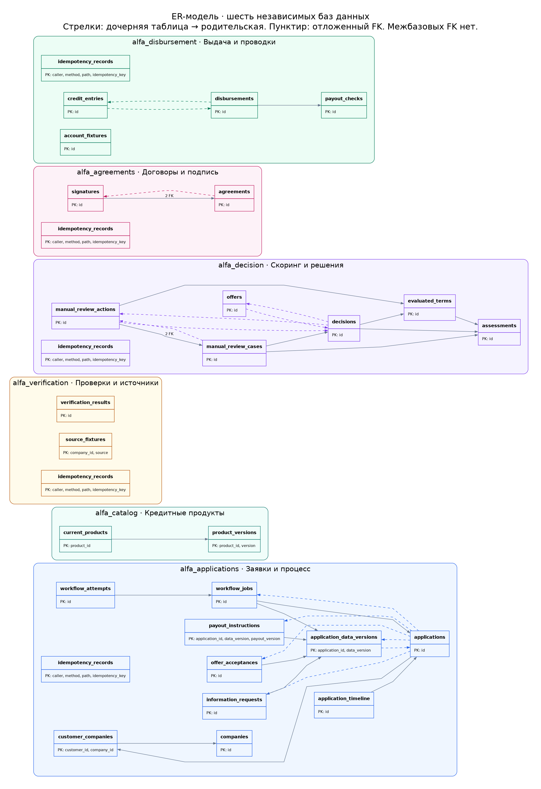

# ER-модель баз данных

31 таблица, 35 внешних ключей, шесть отдельных БД PostgreSQL. Схемы автоматически построены по системному каталогу после применения SQL-миграций.



На общей карте указаны таблицы и первичные ключи. Стрелка идет от дочерней таблицы к родительской; пунктир обозначает FK, проверяемый в конце транзакции. Несколько FK между одной парой таблиц объединены с указанием количества. Межбазовых FK нет: UUID и снимки данных соседних сервисов передаются через API.

## Подробные схемы

SVG сохраняет четкость при увеличении. В подробной схеме показаны все поля, типы и каждый составной FK с точным порядком столбцов.

| Сервис | Назначение | Таблиц | Схема | Изображение | Исходник |
| --- | --- | ---: | --- | --- | --- |
| `applications` | Заявки и процесс | 11 | [SVG](applications.svg) | [PNG](applications.png) | [DOT](applications.dot) |
| `catalog` | Кредитные продукты | 2 | [SVG](catalog.svg) | [PNG](catalog.png) | [DOT](catalog.dot) |
| `verification` | Проверки и источники | 3 | [SVG](verification.svg) | [PNG](verification.png) | [DOT](verification.dot) |
| `decision` | Скоринг и решения | 7 | [SVG](decision.svg) | [PNG](decision.png) | [DOT](decision.dot) |
| `agreements` | Договоры и подпись | 3 | [SVG](agreements.svg) | [PNG](agreements.png) | [DOT](agreements.dot) |
| `disbursement` | Выдача и проводки | 5 | [SVG](disbursement.svg) | [PNG](disbursement.png) | [DOT](disbursement.dot) |

`PK` — первичный ключ; `FK` — внешний ключ; `UQ` — поле входит в ограничение UNIQUE; `?` — допускает NULL; `[G]` — generated column. Составной PK/UNIQUE действует на сочетание полей; отметка UQ у поля не означает уникальность этого поля отдельно.

Изолированные таблицы изображены без искусственных связей: например, verification_results хранит снимок проверки, source_fixtures — изменяемые моки источников. Одинаковый application_id в разных БД является логической ссылкой, а не SQL FK.

В пяти изменяющих сервисах есть собственная idempotency_records. Техническая schema_migrations есть в каждой БД и исключена из ER-схем. CHECK, частичные уникальные индексы и триггеры задают дополнительные правила; диаграммы не заменяют [SQL-миграции](../../services). Определения ограничений и индексов сохранены в [schema.json](schema.json).

## Перегенерация

Нужны Python 3, Docker и Graphviz (`dot`):

```bash
python3 scripts/generate_er_diagrams.py
```

Скрипт создает временный PostgreSQL без сети, применяет миграции и seed, считывает pg_catalog, сохраняет DOT/SVG/PNG и удаляет контейнер. Данные работающего проекта не используются. Общая схема также доступна в [SVG](overview.svg) и [DOT](overview.dot).
