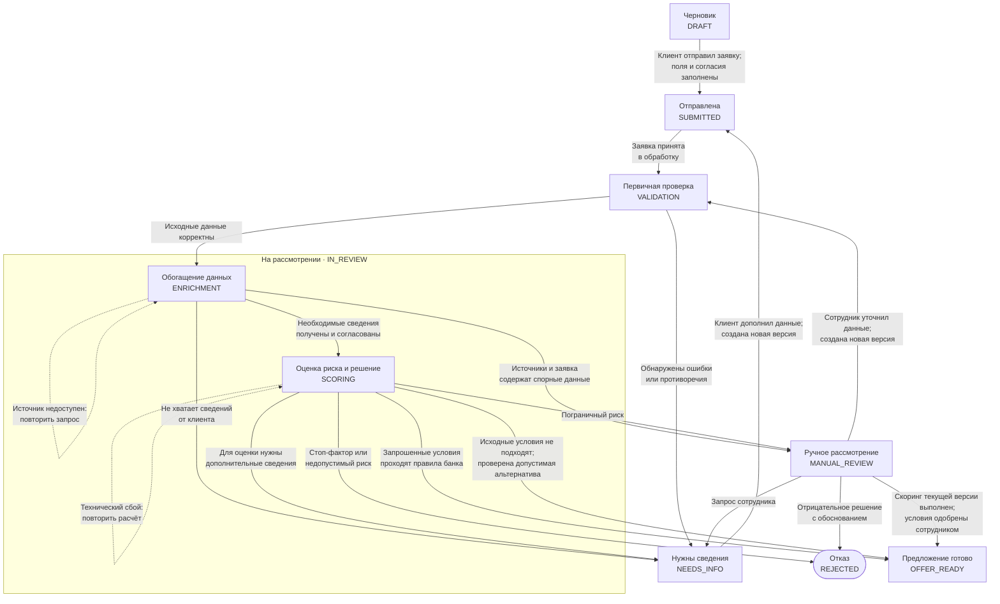
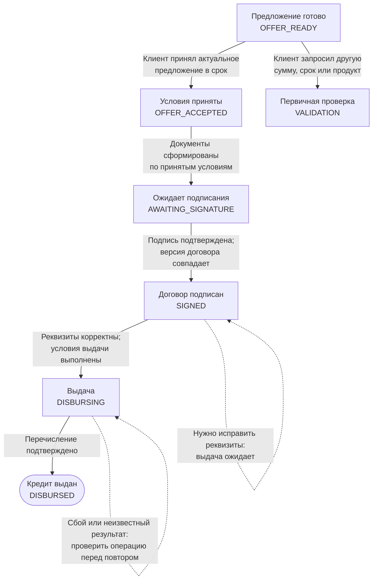
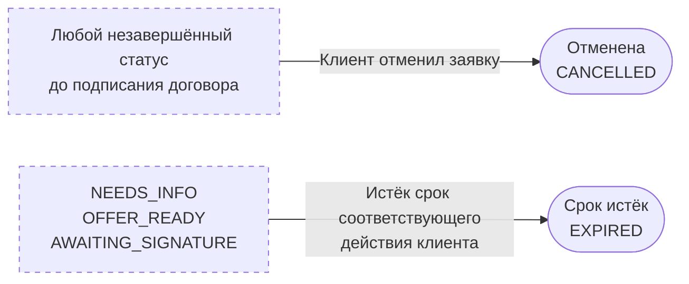

# Бизнес-модель состояний кредитной заявки

Диаграммы фиксируют модель, обсуждённую на основе [требований](../REQUIREMENTS.md): от черновика до моделируемой выдачи, включая дозапрос сведений, ручное рассмотрение, отказ, отмену и истечение срока.

Это бизнес-модель процесса, а не описание реализованного API. Названия статусов и дополнительные ветки необходимо согласовать с контрактами при реализации.

Узлы — статусы заявки, подписи на стрелках — события и условия перехода. `OFFER_READY` и `VALIDATION` на разных диаграммах обозначают одни и те же состояния.

`VALIDATION` — самостоятельный статус первичной проверки после отправки. `IN_REVIEW` — составной статус банковского рассмотрения с двумя последовательными вложенными статусами: `ENRICHMENT` и `SCORING`. Пока заявка находится в `IN_REVIEW`, всегда известен её текущий вложенный статус; отдельного ожидания между ними нет.

| Статус | Что происходит | Условие завершения |
| --- | --- | --- |
| `VALIDATION` — первичная проверка | Сервер проверяет обязательные поля, форматы, согласия и согласованность исходной заявки | Корректная версия данных сохранена; можно получать сведения из других систем |
| `IN_REVIEW / ENRICHMENT` — обогащение | Получаются и сохраняются результаты моков реестра, БКИ, ФНС и используемых внутренних источников; сведения сопоставляются с заявкой | Все необходимые для оценки данные получены и согласованы |
| `IN_REVIEW / SCORING` — оценка риска и решение | Рассчитываются риск, свободный денежный поток и долговая нагрузка; затем применяются кредитные и продуктовые правила | Сохранены оценка риска и отдельное кредитное решение с причинами |

## Подача и рассмотрение

Основной путь рассмотрения: `SUBMITTED → VALIDATION → IN_REVIEW / ENRICHMENT → IN_REVIEW / SCORING`. Вход в `IN_REVIEW` всегда начинает `ENRICHMENT`; его успешное завершение переводит заявку в `SCORING`.

В `ENRICHMENT` сохраняются факты из источников, включая негативные: например, просрочка из БКИ или неактивный статус компании. При наличии полного и согласованного набора данных они передаются в `SCORING`. Скоринг оценивает риск; отдельное кредитное решение затем учитывает эти факты, продуктовые ограничения и параметры кредита. Негативный факт не является ошибкой интеграции, а недоступность источника не является кредитным отказом.

Ошибки отдельных полей по возможности показываются ещё в черновике. Дозапрос после отправки содержит конкретный перечень недостающих сведений или противоречий и срок ответа клиента. Ручное решение сохраняет сотрудника, обоснование и итоговые условия.

Ручное рассмотрение не позволяет пропустить оценку риска: переход в `OFFER_READY` допустим только при наличии завершённого скоринга и подтверждённых проверок для текущей версии данных. Если сотрудник исправил исходные сведения, создаётся новая версия и повторяются `VALIDATION`, `ENRICHMENT` и `SCORING`.

## Предложение, подписание и выдача

Принятие предложения фиксирует его конкретную версию и условия. Изменение суммы, срока или продукта создаёт новую версию заявки, закрывает прежнее предложение и возвращает процесс в `VALIDATION`, затем в `ENRICHMENT` и `SCORING` для нового решения. Документы формируются по принятым условиям; подпись относится к конкретной версии договора.

Ожидание подписания имеет собственный срок. Своевременно принятое предложение не истекает по прежнему сроку принятия во время подготовки или подписания договора.

## Отмена и истечение срока

Пунктирные узлы обозначают группы статусов, а не дополнительные состояния заявки.

Отмена разрешена из `DRAFT`, `SUBMITTED`, `VALIDATION`, `IN_REVIEW` в любом из вложенных статусов (`ENRICHMENT`, `SCORING`), `NEEDS_INFO`, `MANUAL_REVIEW`, `OFFER_READY`, `OFFER_ACCEPTED` и `AWAITING_SIGNATURE`. После подписания отмена в эту модель не входит.

Для `NEEDS_INFO`, `OFFER_READY` и `AWAITING_SIGNATURE` задаются отдельные сроки. При достижении срока (`now >= deadline`) соответствующее действие клиента уже недоступно, даже если фоновая задача ещё не обновила статус.

## Общие правила переходов

- Конечные статусы: `DISBURSED`, `REJECTED`, `CANCELLED`, `EXPIRED`. Повторное обращение после закрытия создаёт новую заявку.
- Отправка сохраняет неизменяемую версию данных. Дополнение заявки создаёт новую версию; существенные изменения требуют повторных проверок и нового решения.
- Каждый переход, включая смену вложенного статуса `ENRICHMENT → SCORING`, сохраняет событие, время, инициатора, причину и версию данных. Изменение статуса и запись истории выполняются атомарно.
- Конкурирующие действия, включая принятие предложения и его истечение, проверяют актуальный статус и срок атомарно. После успешной отмены результаты фоновой обработки не продвигают заявку дальше.
- Техническая ошибка не является кредитным отказом. Текущий бизнес-статус и вложенный статус рассмотрения сохраняются, отдельно фиксируются ошибка, попытки и возможность повтора. Повтор продолжает тот же этап с той же версией входных данных. Петли на диаграммах обозначают повтор или ожидание без смены бизнес-статуса; технические сбои возможны и на других этапах обработки.
- При неизвестном результате выдачи сначала проверяется существующая операция. Повторное выполнение использует тот же ключ операции и исключает двойное зачисление.
- В каждом состоянии клиент видит актуальный статус, причину ожидания и доступное следующее действие.
