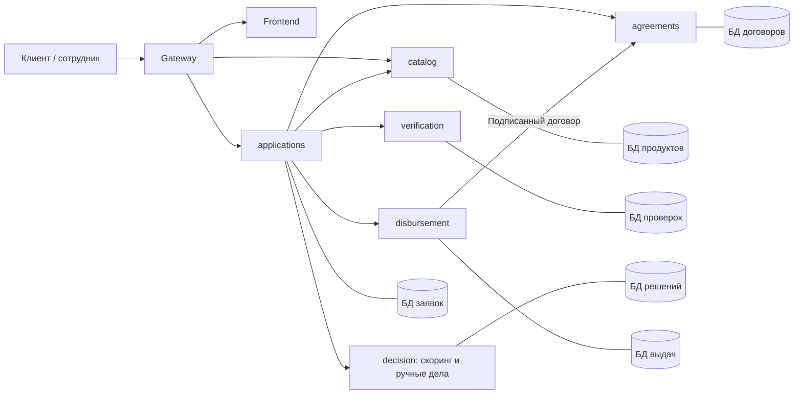

# Архитектура кредитного кабинета

Шесть backend-сервисов, frontend и gateway. Архитектура расширена по [бизнес-модели состояний](application-state-model.md). Дозапрос, ручное рассмотрение, пересмотр условий, отмена и истечение входят в согласованный объем. Все шесть backend-сервисов и frontend приняты в main после ревью. Общий запуск и gateway собраны в корневом `compose.yaml` ([локальный запуск](local-docker.md)); сквозные HTTP-сценарии проверяются браузерными тестами на реальном стеке. Результаты приемки — в [отчетах ревью](reviews/README.md).

## Ответственность сервисов

| Сервис | Ответственность | Собственные данные |
| --- | --- | --- |
| `applications` | Доступ, версии заявки, первичная валидация, составное состояние, дозапросы и сроки, команды клиента/сотрудника, управление процессом | Компании клиента, черновики, неизменяемые версии данных, история, задания, дозапросы, принятые предложения, поручения на выдачу |
| `catalog` | Версии продуктов, ограничения и ставки | Версии продуктов и указатели текущих активных версий |
| `verification` | Моки источников, полнота/согласованность фактов, применение подтвержденных уточнений сотрудника | Фикстуры, исходные и подтвержденные факты, результаты обогащения по версии данных |
| `decision` | Скоринг, автоматическое решение, проверка альтернативных условий, ручные дела и действия сотрудника | Оценки, решения, предложения, дела ручного рассмотрения, обоснования и авторы действий |
| `agreements` | Договор по принятому предложению, срок подписания, подпись и закрытие неподписанного договора | Неизменяемые документы/хеши, подписи, состояние и причина закрытия |
| `disbursement` | Проверка реквизитов поручения, поиск результата операции, однократное моделируемое зачисление | Фикстуры счетов, результаты проверки реквизитов, операции и записи зачисления |

Административная публикация новой версии существующего продукта выполняется только catalog через отдельный публичный admin API. Она не изменяет исторические снимки applications, decision и agreements. Перед первой отправкой черновик должен быть сохранён по актуальным активным условиям: PATCH проверяет данные и обновляет программу, submit устаревшей версии возвращает `409 PRODUCT_NOT_CURRENT`. Уже отправленные заявки продолжают процесс со своими снимками. Администратор продукта — отдельная роль от сотрудника ручного рассмотрения.

Ручное рассмотрение относится к кредитному решению, поэтому остается в `decision`. Дозапросами, сроками и глобальными статусами управляет `applications`. Отдельные сервисы для каждого статуса не нужны.

Frontend использует публичные API `applications` и `catalog`. Команды сотрудника также проходят через `applications`; тот устанавливает личность сотрудника из токена и вызывает внутренний API `decision`. Внутренние порты закрыты в основном Docker-профиле.

## Протокол и управление процессом

HTTP/JSON, долговечные задания в БД `applications`, без брокера. Команда процесса отвечает `202` после атомарного сохранения намерения, задания, истории и идемпотентного ответа. Это подтверждение приема команды; фактический результат клиент читает в заявке. Редактирование черновика — `200`, создание — `201`.

Внутренние POST синхронно сохраняют результат этапа. Оркестратор перед каждым вызовом сохраняет точный запрос, ключ операции и ожидаемые `dataVersion/status/reviewStage`. Результат применяется только при совпадении этих условий. Для этапов одной версии, запускаемых несколько раз, проверяется и ID конкретного задания; для поручения — также payoutVersion.

| Бизнес-этап | Исполнитель | Результат и следующий шаг |
| --- | --- | --- |
| `DRAFT → SUBMITTED` | applications | Проверены структура/обязательные поля/согласия, сохранена версия данных |
| `SUBMITTED → VALIDATION` | applications | Долговечное задание первичной проверки |
| `VALIDATION` | applications | Согласованные данные → `IN_REVIEW/ENRICHMENT`; противоречия → `NEEDS_INFO` |
| `IN_REVIEW/ENRICHMENT` | verification | Полные подтвержденные факты → `SCORING`; нехватка сведений → `NEEDS_INFO`; спорные факты → `MANUAL_REVIEW` |
| `IN_REVIEW/SCORING` | decision | Оценка риска и отдельный исход: предложение, отказ, дозапрос или ручное рассмотрение |
| `MANUAL_REVIEW` | decision, команда через applications | Обоснованное одобрение/отказ, дозапрос либо уточнение данных с новой версией |
| `OFFER_READY → OFFER_ACCEPTED` | applications | Зафиксированы конкретное предложение, версия данных и `acceptedAt` |
| `OFFER_ACCEPTED` | agreements | Документ готов → `AWAITING_SIGNATURE`, установлен отдельный срок подписи |
| `AWAITING_SIGNATURE` | agreements | Подтвержденная подпись → `SIGNED`; технический сбой оставляет прежний статус |
| `SIGNED` | disbursement | Проверка реквизитов: готово → `DISBURSING`; исправление → ожидание в `SIGNED` |
| `DISBURSING` | disbursement | Подтвержденная операция → `DISBURSED`; неизвестный исход сначала разыскивается |

Сведения о версиях, точные guards и API-команды описаны в [workflow](workflow.md) и [контрактах](../contracts/README.md).

## Изменения данных и предложения

`version` — версия агрегата для конкурентных команд. `dataVersion` — последовательный номер неизменяемого снимка исходных данных; первая отправка создает снимок 1. Редактирование черновика увеличивает только `version`. Дозапрос, правка сотрудника и изменение условий создают снимок `dataVersion + 1`; старые снимки и результаты остаются доступны.

Смена продукта/суммы/срока в `OFFER_READY` закрывает прежнее предложение и возвращает заявку в `VALIDATION`. Уточнение из `NEEDS_INFO` сначала возвращает в `SUBMITTED`, затем в `VALIDATION`. Правка сотрудника из `MANUAL_REVIEW` возвращает в `VALIDATION`. Во всех случаях повторяются обогащение и скоринг; старые результаты не переиспользуются как подтверждение новой версии.

Предложения и результаты неизменяемы в сервисе-владельце; их актуальность для принятия хранит `applications`. Одна версия может иметь автоматическую оценку и последующее ручное решение. Ручное одобрение требует завершенного скоринга и подтвержденных проверок именно текущей версии. Неподтвержденные факты уточняются с новой версией, затем процесс проходит проверки заново.

## Технические ошибки и однократное выполнение

Ошибка не меняет бизнес-статус и `reviewStage`. В отдельном `technicalError` сохраняются этап, код, попытки и возможность повтора; задание приостанавливается. Frontend показывает причину ожидания и действие повтора. Негативные факты источника — успешный результат обогащения и вход для решения, не ошибка интеграции.

- Локально атомарны: команда/задание/история/ответ; результат сервиса/его ответ; подпись/статус договора; выдача/запись зачисления.
- Worker использует lease и токен владения. После падения задание возвращается в обработку. Поздний результат старой версии или отмененной заявки сохраняется у исполнителя, но не продвигает агрегат.
- HTTP-таймаут 10 секунд, соединение 2 секунды. Сетевые сбои, `408`, `429`, `5xx` и `409 IDEMPOTENCY_IN_PROGRESS` повторяются до пяти попыток; задержки 1/2/4/8 секунд с jitter, учитывать `Retry-After`. Другие ошибки протокола приостанавливают этап сразу. Исключение — ожидаемые гонки подписи/закрытия/срока: AGREEMENT_CLOSED, AGREEMENT_ALREADY_SIGNED и DEADLINE_EXPIRED разрешаются чтением фактического договора.
- При ручном повторе точные входные данные и ключ сохраняются; счетчик текущего запуска сбрасывается, история попыток остается.
- У выдачи заранее выделяется постоянный `operationId`. После неизвестного ответа сначала GET по нему; найденное зачисление применяется к заявке. При `404` допустим повтор только с прежними `operationId`, ключом и телом. `404` не доказывает отсутствие параллельно выполняющейся операции.
- Уникальность выдачи по `applicationId`, `agreementId` и `operationId` и одна транзакция зачисления предотвращают повторный платеж даже с другим ключом.

## Отмена и гонки с подписью

До подписания отмена разрешена во всех перечисленных в бизнес-модели статусах. После фиксации `CANCELLED` новые фоновые результаты игнорируются. Из `DRAFT` и до `AWAITING_SIGNATURE` команда отмены может завершиться сразу (`200`); незавершенное создание документа может оставить закрываемый техническим заданием документ, но подписать его через отмененную заявку нельзя.

Из `AWAITING_SIGNATURE` отмена принимается как `202` и сначала закрывает договор в `agreements`. Операции `sign` и `close` конкурируют в одной транзакционной блокировке договора: из `READY` побеждает только одна. При закрытии с причиной CANCELLED оркестратор фиксирует `CANCELLED`, при уже зафиксированной причине EXPIRED — `EXPIRED`; при подтвержденной подписи отмена не выполняется, оркестратор сверяет подпись и фиксирует `SIGNED`. Пока исход не определен, выдача не запускается. Аналогично разрешается гонка истечения срока с подписью. `202` не обещает окончательную отмену.

Сроки проверяются атомарно и в приложении, и при подписании договора. После deadline действие отсутствует в `availableActions`, даже если таймер еще не записал `EXPIRED`. Собственный `signBy` договора не зависит от прежнего срока принятия предложения.

## Данные, доступ и поставка

Один локальный PostgreSQL-контейнер, шесть БД и отдельных пользователей приложений; владельцы схем имеют NOLOGIN. Межбазовые JOIN и FK отсутствуют. Предметная модель — в [модели данных](data-model.md), готовые SQL-миграции/ER-диаграммы и запуск — в [описании БД](../database/README.md). DB-профиль использует PostgreSQL 16.15 с зафиксированным digest образа. Все шесть backend-сервисов реализуются на Java 21 и запускаются на JVM 21; версии сборки и зависимостей фиксируются по [требованиям к стеку](backend-stack.md).

Авторизация MVP: настроенные `DEMO_CUSTOMER_TOKEN/ID` и отдельные `DEMO_STAFF_TOKEN/ID`. `applications` проверяет владельца или роль сотрудника; `catalog` принимает клиентский и внутренний токен. Внутренние API требуют `INTERNAL_API_TOKEN`. Клиент не задает сотрудника/инициатора или итог решения. Чужой клиентский ресурс — `404`, недостаточная роль — `403`. Общий внутренний секрет и статические демотокены — допущение прототипа.

Данные синтетические, деньги — целые рубли, ставки/отношения — базисные пункты, время — UTC с `Z`. Договор моделирует обязательства и условия кредита; реквизиты поручения на зачисление хранятся отдельно, поэтому исправление реквизитов в `SIGNED` не изменяет подписанный документ. Выдача проверяет принадлежность демосчета компании по собственной синтетической фикстуре.

Gateway публикует только 8080, маршрутизирует `/api/v2/products*` в catalog, `/api/v2/companies*`, `/api/v2/applications*`, `/api/v2/staff/*` в applications с удалением `/api`. `/` обслуживает frontend. Для VPS требуется TLS. Логи: `X-Request-Id`, заявка, версия данных, этап, код; без токенов и полных финансовых данных. История содержит автора, причину и версии каждого перехода, включая смену вложенного статуса.

Целевая команда после реализации — `docker compose up --build`. Уже готовы SQL-миграции, seed и отдельный DB-профиль; при реализации каждый сервис должен получить Dockerfile, lock-файл и `/health/live`, `/health/ready`. Readiness проверяет собственную БД и сидирование. Реальные банковские интеграции, ЭП, деньги, OCR и LLM не нужны.

## Изменение контракта

Предыдущая спецификация v1 описывала упрощенный процесс и не была реализована. Она заменена v2 (`/v2`, OpenAPI `2.0.0`): составное рассмотрение, версии данных, ручные решения, новые команды и реквизиты. Файлы спецификаций сохранили прежние имена. Реализовывать нужно только актуальный v2; миграция работающих данных v1 не предполагается.

| Предыдущее обозначение | Актуальная модель |
| --- | --- |
| CHECKING | Отдельные SUBMITTED, VALIDATION, затем IN_REVIEW / ENRICHMENT |
| SCORING как глобальный статус | IN_REVIEW с reviewStage=SCORING |
| OFFERED / DECLINED | OFFER_READY / REJECTED |
| PREPARING_AGREEMENT | OFFER_ACCEPTED с заданием подготовки документа |
| SIGNING | AWAITING_SIGNATURE с заданием подписи; подтверждение дает SIGNED |
| OFFER_EXPIRED | EXPIRED с причиной OFFER_TIMEOUT; также поддержаны другие сроки |
| PROCESSING_ERROR | Прежний бизнес-статус и отдельный technicalError |
| submissionVersion | dataVersion снимка отдельно от version агрегата |
